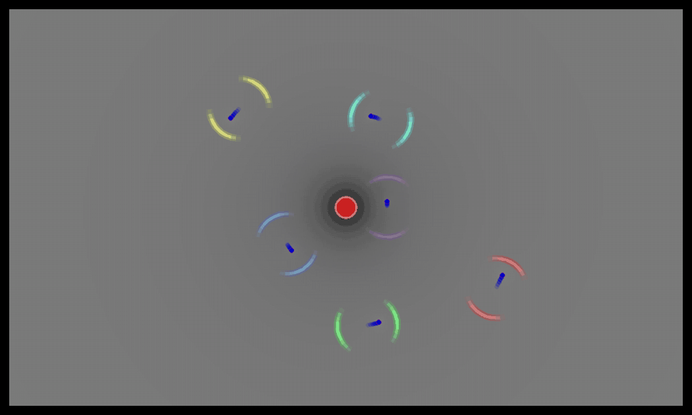

# FREE1105: Funky Radical Electrodynamics Engine

[](https://github.com/Vagabond1105/FREE1105/actions/workflows/tests.yml)
[](LICENSE)


A 2D classical electrodynamics sandbox, written from scratch in Python. You place point charges, give them masses, velocities and restitution, press **Start**, and Coulomb's law takes it from there. Accelerating charges radiate, and you can see the light leave them.



*Six negative charges orbit a fixed positive one, radiating at the real speed of light. Each orbit turns at its own frequency, so each one gets its own colour and sends out one pair of wavefronts per orbit. This GIF is rendered by the actual engine ([`tools/make_demo_gif.py`](tools/make_demo_gif.py)).*

**Status: complete (v1.0, October 2026).** The project did what it set out to do. The list of [possible extensions](#possible-extensions) is there for anyone who wants to take it further, not a to-do list.

### What's in it

- **A symplectic integrator that actually keeps its promises.** Velocity-Verlet, with the energy shown live and never "corrected". Over 50 orbits the energy error stays below 1.2×10⁻⁹ and does not drift.
- **Larmor radiation**, checked against the analytic formula to 0.03%, with full energy bookkeeping: KE + PE + radiated = E₀.
- **Impulse-based collisions** between particles and with walls, with adjustable restitution.
- **A live potential heatmap**, plus a **3D potential surface** in its own window.
- **16 automated tests** that rerun every number in the [Verification](#verification) section on every push.
- **An honest list of everything the model gets wrong** compared with real physics. It is long. That is the point.

## Contents

- [Run it](#run-it) · [Controls](#controls)
- [Development history](#development-history): how it was built, phase by phase
- [Physics](#physics): what the engine actually computes
- [Shortcomings vs real life](#shortcomings-vs-real-life): what's simplified or wrong, and why
- [Verification](#verification): measured numbers, and the tests that produce them
- [Architecture](#architecture) · [Authorship](#authorship) · [Fix log](#fix-log) · [Possible extensions](#possible-extensions) · [License](#license)

---

## Run it

Needs Python 3.10 or newer.

```bash
git clone https://github.com/Vagabond1105/FREE1105.git
cd FREE1105
pip install -r requirements.txt     # pygame, numpy, matplotlib
python main.py
```

The 3D potential window opens next to the main window.

**Run the tests** (headless, about 10 seconds):

```bash
python -m unittest discover -s tests -v
```

**Regenerate the demo GIF** (needs `ffmpeg`):

```bash
python tools/make_demo_gif.py
```

**If the 3D window doesn't show up:** on Ubuntu and Debian, having matplotlib installed both from apt (`python3-matplotlib`) and from pip used to break 3D plotting. The visualiser now works around this itself. If it still fails, the terminal prints the error and the 2D simulation carries on without it. A virtual environment avoids the problem entirely.

## Controls

| Where | Control | What it does |
|---|---|---|
| Setup | Right-click empty space | Menu, then create a charge: charge, mass, velocity (angle wheel), restitution, *environmental*, *static* |
| Setup | Right-click a charge | Edit or delete it |
| Setup | Left-drag / double-click | Move a charge / duplicate it |
| Setup | Arrows on charges | Show the initial velocity (relative length) |
| Any | **Start / Pause / Reset** | Run the simulation. Reset deletes the non-environmental charges and returns the rest to their initial position and velocity |
| Top-left | Wall restitution slider | 1 = elastic walls, below 1 = energy lost per bounce |
| Top-right | Time step, max FPS | Simulation speed and accuracy |
| Top-right | **Radiation ON/OFF** | Larmor radiation at the real speed of light. Accelerating charges send out wavefronts |
| Running | TRAILS | Fading trails |
| Bottom-left | Energy readout | KE, PE, radiated energy, total, relative change since Start, and the largest v/c when radiation is on |

Charge size scales with |q| and border thickness with mass, both relative to the other charges on screen.

If extreme inputs make the numbers overflow (huge charges, tiny masses, a big time step), the simulation pauses and the readout tells you to press Reset. It does not crash.

---

## Development history

The original plan, from the first cell of the notebook, had five phases:

1. Set up electric fields in a 2D coordinate system
2. Simulate the motion of point charges
3. Simulate the motion of charged rigid bodies
4. Visualise the field via geometrical curvature
5. Implement Maxwell's 4th law for magnetic fields and light

Every phase in the notebook follows the same structure: a checklist of aims, a planned architecture, then a frank "How it actually went". Its `%%writefile` cells regenerate the code as it stood at the end of each phase (`*_jypter1.py`, `*_jupyter2.py`), so any intermediate stage can be run.

### Phase 1: fields and the sandbox (November 2025)

**Aims:** a window with walls; point charges with *static* (pinned) and *environmental* (survives a reset) flags; superposing their fields; the field as a background heatmap; a reset button; a right-click menu for creating and dragging charges.

**Design:** five modules (main loop, shared constants, `PointCharge` class, field renderer, GUI). Charge size encodes |q| and border thickness encodes mass, each relative to the other charges. To keep the per-pixel field sum affordable, the heatmap is computed on a ¼-resolution virtual screen and scaled up, which is 16× less work.

**How it went:** the physics and maths were the easy part. The GUI widgets (text boxes, toggles, the form layout) were mostly AI-generated after several attempts that I scrapped and restarted. My notes say it plainly: micromanaging pixel layouts was the least enjoyable part of the whole project.

### Phase 2: motion, integrators and collisions (late November 2025)

**Aims:**
- a Start button that locks editing;
- a three-state machine (SETUP / RUNNING / PAUSED), so dragging a charge can never race the force calculation;
- reset back to initial conditions;
- particle-particle and particle-wall collisions with adjustable restitution;
- fading trails;
- initial velocities from an angle wheel and a mantissa/exponent input, shown as scaled arrows before the run;
- time-step and FPS sliders so the motion is watchable.

**The integrator journey.** This was the core of the phase, and it went in four sets:

1. **Explicit Euler.** Energy grew steadily and orbits spiralled outward. Euler skipped leg day.
2. **RK2.** Smoother, still drifted.
3. **RK4.** Accurate over short runs, but not symplectic, so over long runs the energy still drifted.
4. **Velocity-Verlet.** Adopted on someone's advice to use a symplectic integrator. The energy now oscillated inside a bounded band instead of drifting. That observation is the central numerical result of the project. See [Physics](#3-time-integration-velocity-verlet).

**How it went:** exhausting. The GUI and the first draft of the physics engine were AI-generated. The integration, debugging and tuning were mine, and it took many cycles of breaking something, debugging it, then relearning my own code. I tuned the softening and the collision handling until the energy behaved.

### Phase 3: charged rigid bodies (not built)

The plan was triangle and rectangle bodies that could be dragged, rotated and scaled, with charge spread along an axis through an editable distribution, plus strings between particles. It was set aside for time and is listed under [possible extensions](#possible-extensions).

### Phase 4: the potential as geometry (February 2026)

The potential V(x, y) is drawn as a 3D surface. Positive charges raise it and negative charges dent it, much like the rubber-sheet picture of spacetime curvature. I built this before phases 3 and 5 because it was the most self-contained piece (mostly matplotlib) at a time when other commitments left little time.

### October 2026: review and fixes

An AI-assisted code review found real problems: an energy "correction" that made the conservation check true by construction, a heatmap that wasn't the potential, forces computed three times per step in Python loops, an inconsistent force/potential clamp, and matplotlib running outside the main thread. All fixed. Details in the [fix log](#fix-log).

### Phase 5a: Larmor radiation (October 2026)

This is the first step of the original phase 5 ("magnetic fields and light"). Accelerating charges radiate, lose kinetic energy, and show their emission on screen. My design was:
- light is emitted perpendicular to the acceleration;
- the energy comes out of KE;
- the colour runs from red to violet, ranked by the frequency of each charge's motion;
- c is the real speed of light (an early version had a slider that lowered it);
- the emission is drawn as 90° wavefronts, one pair per cycle of the motion.

I chose to colour by the frequency of the motion rather than by power, because frequency is what sets the colour of real emitted light. The implementation was AI-written to this design. See [Physics § 5](#5-larmor-radiation).

### Finishing (October 2026)

The last pass made the repository something other people can trust and run: a test suite that reproduces every claimed number, continuous integration, the demo GIF, an MIT license, and three bug fixes (see the [fix log](#fix-log)). Then the project was declared complete. Alhamdulillah.

---

## Physics

### 1. Coulomb force with Plummer softening

Every pair of charges interacts through a softened Coulomb force:

$$\vec F_{ij} = k_e\, q_i q_j \, \frac{\vec r_i - \vec r_j}{\left(|\vec r_i - \vec r_j|^2 + \varepsilon^2\right)^{3/2}}, \qquad \varepsilon = 400\ \text{px}.$$

This force is exactly $-\nabla$ of the softened potential energy

$$U = \sum_{i<j} \frac{k_e\, q_i q_j}{\sqrt{r_{ij}^2 + \varepsilon^2}},$$

so the force and the energy readout always describe the same physics (a test checks this by finite differences). Softening removes the $r \to 0$ singularity. Without it, a close pass between opposite charges produces arbitrarily large accelerations that no fixed time step can resolve. The technique comes from gravitational N-body codes, and 400 px was chosen empirically by watching the energy during close encounters.

All pairs are evaluated in one NumPy broadcast. The cost is O(N²), which is fine for tens of charges.

### 2. Units

SI constants ($k_e$, $e$, $m_e$, $m_p$, $c$) with **1 px treated as 1 m**. The creation form defaults to 1 C and 1 kg. These magnitudes are wildly unphysical (1 C is an enormous charge), but they give motion on a human timescale.

### 3. Time integration: Velocity-Verlet

$$x_{n+1} = x_n + v_n \Delta t + \tfrac{1}{2} a_n \Delta t^2, \qquad v_{n+1} = v_n + \tfrac{1}{2}(a_n + a_{n+1}) \Delta t$$

Velocity-Verlet is **symplectic**: it preserves the phase-space structure of Hamiltonian mechanics. It exactly conserves a "shadow Hamiltonian" that differs from the true energy by $O(\Delta t^2)$, so the energy error **oscillates inside a bounded band and does not drift**, even over very long runs. RK4 has higher order but no such guarantee, which is why molecular dynamics codes (GROMACS, LAMMPS) and N-body codes use Verlet-type schemes. Reflect on that for a second. A lower-order method wins because it respects the structure of the problem.

The engine evaluates forces once per step: $a_{n+1}$ is cached and reused as the next step's $a_n$, unless collisions, walls or dragging moved a particle in between.

### 4. Collisions

- **Particle-particle:** an impulse along the contact normal, using the reduced mass and an effective restitution $e = \min(e_1, e_2)$. A positional correction of 80% of the overlap then separates the pair without overshooting.
- **Walls:** the normal velocity is reflected and multiplied by the wall restitution (slider).
- With restitution below 1, energy is lost, as it should be.

### 5. Larmor radiation

**Power.** A non-relativistic accelerating charge radiates

$$P = \frac{q^2 a^2}{6\pi\varepsilon_0 c^3} = \frac{2}{3}\,\frac{k_e\, q^2 a^2}{c^3}.$$

Here $a$ is the **net** acceleration. Fields superpose before they are squared, so a charge pulled equally in two opposite directions doesn't radiate. Neutral and static charges never radiate.

**Direction.** The angular distribution is

$$\frac{dP}{d\Omega} \propto \sin^2\theta,$$

with θ measured from the acceleration. No light goes along the force; the maximum is perpendicular to it. In 3D this is a doughnut around the acceleration axis.

**What you see.** Each radiating charge sends out pairs of **90° arcs perpendicular to the net force**, one on each side, that spread outward as wavefronts. The 90° is not decoration: it is the half-power width of the pattern ($\sin^2\theta \ge \tfrac12$ for θ between 45° and 135°). Brightness along each arc follows the pattern, brightest in the middle and fading to the edges. A wavefront stays centred on the point where it was emitted, because light does not follow its source. A charge on a circular orbit is accelerated towards the centre, so it sends light forward and backward along its path and leaves a wake of arcs. The arcs travel at a display speed of 4000 px per simulated second; the real c would cross the screen in about 5 μs.

**Energy loss.** The pattern is front-back symmetric, so the light carries away energy but **no net momentum**. Each step, a radiating charge loses $P\,\Delta t$ of kinetic energy: its speed is scaled down and its direction is unchanged. This energy drain is used instead of the Abraham-Lorentz self-force $\frac{2}{3}k_e q^2 \dot{\vec a}/c^3$, which has unphysical runaway solutions. Averaged over the motion, both give the same energy loss. The radiated energy is tallied, and the readout shows

$$KE + PE + E_{\text{rad}} = E_0,$$

so energy bookkeeping remains a consistency check. Energy is a trust; the code returns every joule of it, and the readout keeps the receipts.

**Colour and rhythm.** Real emitted light has the frequency of the motion that produces it. For circular motion that frequency is exactly $\omega = a/v$, and the ratio is a good estimate in general. Each charge's wavefronts are coloured by $\omega$ on a log scale relative to the other charges on screen: the slowest-turning charge is **red** and the fastest is **violet**, following the visible spectrum. The ripple rate is **one to one** with the motion: one pair of arcs per cycle, every $T = 2\pi/\omega$ of simulated time. Twice the frequency gives twice the ripples and half the on-screen wavelength ($\lambda = v_{\text{display}} T$). Brightness shows the relative radiated **power**, also on a log scale, because $P \propto a^2$ spans many orders of magnitude and a linear scale would leave everything but the strongest emitter invisible.

**Strength.** c is the real $3\times10^8$ m/s. At that value, charges moving at a few thousand px/s radiate almost nothing: about $10^{-15}$ of the orbital energy per orbit, so orbits don't visibly decay. The wavefronts are drawn on a relative scale, so they still show where and how strongly each charge radiates. The readout tallies the radiated energy and shows the largest $v/c$, which turns red above 0.3 because the formula assumes $v \ll c$. The tests lower c on purpose, to make the energy loss large enough to measure.

### 6. Potential heatmap and 3D surface

Both show the scalar potential $V(x,y) = \sum_i k_e q_i / r_i$, with $r_i$ held at the particle's radius inside its disc.

- **2D heatmap:** computed on a ¼-resolution grid. Positive potential is darker, negative is lighter, zero is mid-grey.
- **3D surface:** height and grey level encode the normalised V, with a blue wireframe and the charges marked (red +, blue −).
- **Process model:** the 3D window runs in **its own process**, because matplotlib's GUI must own its process's main thread. The simulation sends it a JSON snapshot of the charges at 5 Hz over a pipe.

---

## Shortcomings vs real life

This is a teaching-grade classical model. The list is deliberately thorough, and several entries are good physics in their own right.

### Electrodynamics that's missing

| Simplification | Real physics | Consequence here |
|---|---|---|
| **Electrostatic forces only.** No magnetic force between moving charges | Moving charges make magnetic fields, and the force is the full Lorentz force $q(\vec E + \vec v\times\vec B)$. The magnetic interaction is smaller by about $(v/c)^2$ | With the real c, $v/c \sim 10^{-5}$, so the error is negligible |
| **Instantaneous action at a distance** | Fields propagate at c. Each charge feels the others where they were at the *retarded* time (Liénard-Wiechert potentials) | Same order as above: fine for $v \ll c$ |
| **3D Coulomb law in a 2D world** | Genuine 2D electrostatics has a logarithmic potential and a 1/r force | These are really 3D charges confined to a plane. The radiation arcs are a slice of the 3D doughnut |
| **Softening, ε = 400 px** | Point charges obey $1/r^2$ down to (at least) nuclear scales | ε is comparable to the screen size, so this is a big modification. At 300 px the force is only **22%** of the true Coulomb value, and at short range it flattens out instead of diverging. The motion is qualitatively Coulomb-like but quantitatively softer |
| **Conducting walls aren't modelled** | A real conducting wall induces image charges and attracts nearby charges | Walls only reflect particles mechanically |

### Radiation

| Simplification | Real physics | Consequence here |
|---|---|---|
| **Non-relativistic Larmor** | Liénard's relativistic formula grows as $\gamma^6$, and at high speed the emission is beamed forward along $\vec v$ (the synchrotron "headlight") | Valid only while $v \ll c$. The readout warns above $v/c = 0.3$ |
| **Energy drain instead of a self-force** | Radiation reaction is a subtle, still-debated problem (Abraham-Lorentz-Dirac, Landau-Lifshitz) | Correct energy loss rate, but the instantaneous force direction isn't modelled. A charge momentarily at rest has no KE to lose that step, so that step's emission isn't tallied |
| **Wavefronts are drawn, not simulated** | Light travels at c and its fields act on other charges | The arcs picture the emission pattern at a display speed. They carry no field |
| **Collisions don't radiate** | A sudden stop radiates strongly (bremsstrahlung: the X-rays in an X-ray tube) | Collision and wall impulses are instantaneous, so $a$ would be infinite. They are excluded |
| **Emitted light doesn't interact with anything** | Radiation pushes on other charges (absorption, scattering) | Energy simply leaves the system |
| **Colour is relative** | A charge circling at ω = 20 rad/s emits ~3 Hz radio waves, nowhere near visible light | Red to violet ranks the charges by frequency. It is not the true colour |
| **Classical radiation, no photons** | Light comes in quanta, and atoms have stable ground states | See below |

### Things only quantum mechanics fixes

- **The classical atom collapses.** A classical electron orbiting a proton at the Bohr radius radiates its energy away and spirals into the nucleus in about **1.6×10⁻¹¹ s**. This was one of the main reasons physics needed the Bohr model and then quantum mechanics. The radiation here is exactly that classical physics, but at the real c and with slow, metre-scale orbits the collapse takes far too long to watch.
- **Opposite charges should collapse even without radiation.** Point charges with a pure $1/r^2$ attraction meet in finite time. Two artificial things stop it here: softening, and treating charges as hard discs that bounce. In reality the uncertainty principle and the Pauli exclusion principle keep atoms from collapsing.

### Mechanics and numerics

| Simplification | Note |
|---|---|
| Charges are hard discs with restitution | Real charges don't have contact collisions; this is a sandbox mechanic. The positional correction can create or remove small amounts of energy |
| Collisions are applied after the Verlet step | This slightly breaks symplecticity: energy is bounded between collisions, not through them |
| Fixed time step | No adaptive stepping. Close encounters need a smaller dt (slider) |
| Static charges are pinned with infinite mass | An idealisation; real "fixed" charges are held in place by forces |
| O(N²) forces | Fine for tens of charges; thousands would need Barnes-Hut or a GPU |
| Heatmap at ¼ resolution; V held constant inside each disc | Visual approximations |

---

## Verification

Every number below is produced by [`tests/test_physics.py`](tests/test_physics.py), which runs on every push ([CI](.github/workflows/tests.yml)). The orbit tests use one setup: a charge orbiting a fixed opposite charge, q = ±1 C, m = 1 kg, r = 300 px, ε = 400 px, 400 steps per orbit, no walls or collisions, with the speed set so the orbit is circular in the softened potential.

| Test | Measured result |
|---|---|
| Energy conservation, radiation off, 50 orbits | $\lvert E - E_0\rvert / \lvert E_0\rvert < 1.2\times10^{-9}$. Mean error $6.2\times10^{-10}$ over the first orbit and $5.0\times10^{-10}$ over the last: **no drift** |
| Circular orbit, 10 orbits | Radius stays within 0.1% of 300 px |
| Force vs potential | Force equals $-\nabla U$ (central finite differences) to 6 significant figures |
| Momentum, free pair of charges | Conserved to $10^{-6}$ |
| Radiated energy vs analytic Larmor, c = 10⁵ px/s, 20 orbits | Simulated $4.1354\times10^4$ J vs analytic $P \cdot 20T = 4.1342\times10^4$ J (**0.03%**) |
| Energy bookkeeping with radiation, c = 3×10⁴ px/s, 20 orbits | Orbit decays from 300 to 253 px, and $\lvert KE + PE + E_{\text{rad}} - E_0\rvert / \lvert E_0\rvert < 4.6\times10^{-6}$ |
| Radiation at the real c vs radiation off, 5 orbits | Positions agree to $6\times10^{-10}$ px |
| Neutral and static charges | Never radiate |
| Collisions | Elastic: momentum and KE conserved. Head-on with e = 0.5: each rebounds at half speed. Walls: normal velocity × restitution |
| Wavefronts | Exactly one pair per orbit |
| 3D surface potential | Matches $\sum_i k_e q_i / r_i$ |

During the October 2026 review, the vectorised forces were also checked against the original loop code: identical apart from one pair inside the old 20 px clamp, and about 33× faster at N = 20. The numbers do not lie, and neither does this table.

---

## Architecture

```
FREE1105/
├── main.py                       # loop, state machine (SETUP / RUNNING / PAUSED), rendering, energy readout
├── physics_engine.py             # softened Coulomb, Velocity-Verlet, Larmor radiation, collisions, energy
├── point_charges.py              # PointCharge (state, trails, arrows, drawing) and the radiation wavefronts
├── electric_field.py             # 2D potential heatmap (¼-resolution grid, scaled up)
├── phase4_visualiser.py          # 3D potential surface, run as a separate process
├── gui.py                        # buttons, sliders, toggles, creation form
├── constants_for_all_files.py
├── tests/test_physics.py         # 16 headless tests behind the Verification table
├── tools/make_demo_gif.py        # renders assets/demo.gif with the real engine
├── FREE1105 Primary Notebook.ipynb   # development log, phase by phase
├── requirements.txt
└── LICENSE
```

**Each frame while running:**

1. **Verlet position update**, using the cached $a_n$.
2. **New forces**, giving $a_{n+1}$.
3. **Verlet velocity update.**
4. **Larmor energy drain**, if radiation is on.
5. **Wall collisions**, then **particle collisions**.
6. **Overflow check**: pause instead of crashing if anything became inf or NaN.
7. **Wavefronts**: emit and advance, in simulated time.
8. **Energy diagnostics**, including the radiated energy.

---

## Authorship

- **Phase 1 (Nov 2025):** physics, field calculation and architecture are mine. The GUI widgets were largely AI-generated.
- **Phase 2 (Nov 2025):** I designed and debugged it, including the state machine, collision handling and the Euler, RK2, RK4, Verlet progression and its tuning. The GUI and the first draft of the physics engine were AI-generated, then integrated and reworked by me.
- **Phase 4 (Feb 2026):** lightly AI-assisted.
- **October 2026 review:** an AI-assisted review found the issues in the fix log, and the fixes and clean-up were AI-implemented.
- **Phase 5a, radiation (Oct 2026):** the design is mine (direction, energy drain from KE, red-to-violet frequency colours, real c, 90° wavefronts at one pair per cycle). The implementation was AI-written.
- **Finishing (Oct 2026):** tests, CI, demo GIF and the final bug fixes were AI-written at my direction.
- **This README:** written by Claude (an AI) from the code, the git history and my notebook notes.

## Fix log

### October 2026 review

| Issue found | Fix |
|---|---|
| In fully elastic mode, velocities were rescaled every step to force the total energy back to $E_0$, so the conservation check was true by construction | Rescaling removed. The energy is displayed live, as measured |
| The 2D heatmap summed signed $kq/r^2$, which is neither the potential nor the field strength | The heatmap now shows the potential $kq/r$, the same quantity as Phase 4 |
| Forces were evaluated 3× per step (one result discarded) in pure-Python double loops | One evaluation per step, vectorised: about 33× faster at 20 charges |
| A 20 px minimum-distance clamp made the force and the potential disagree at close range | Clamp removed. Softening alone regularises the force, consistently |
| Matplotlib ran in a background thread, which isn't thread-safe and can crash | The visualiser runs as a separate process |
| A per-frame debug print of every particle flooded the terminal and slowed the loop | Removed |
| Repo clutter: generated stage files, `__pycache__`, editor settings, a 1 MB notebook (10k lines of debug output) | Removed or git-ignored; notebook outputs cleared (160 KB); `requirements.txt` added |

### Finishing pass

| Issue found | Fix |
|---|---|
| Reset never deleted non-environmental charges, despite the design saying so: a global handler switched to SETUP first, so the code that deleted them could never run | One Reset handler, in every state, that does what the design says |
| On Ubuntu/Debian with matplotlib from both apt and pip, the 3D window crashed on start ("Unknown projection '3d'"), silently, because it runs in a separate process | The visualiser loads the 3D toolkit that matches its matplotlib, and the main window reports it if the 3D window ever dies |
| Extreme inputs could overflow to inf/NaN and crash the renderer | The simulation pauses with a message instead |

## Possible extensions

None of these are planned. They are what would come next if someone picked it up.

- **Magnetism:** velocity-dependent (Darwin) forces and $\vec v \times \vec B$.
- **Retardation:** fields propagating at c (Liénard-Wiechert), so the wavefronts become real fields rather than a picture.
- **Rigid bodies (the original phase 3):** charged triangles and rectangles with torque from non-uniform charge distributions; strings.
- **Bremsstrahlung** on collisions, given finite-duration contacts.
- **Barnes-Hut** $O(N\log N)$ forces, or a GPU, for large N.

## License

[MIT](LICENSE). Anyone can use, copy, modify and share this code, for any purpose, including commercially. Just keep the copyright notice.

---

*Built as a self-directed computational physics project alongside a Theoretical Physics degree, 2025-26.*


